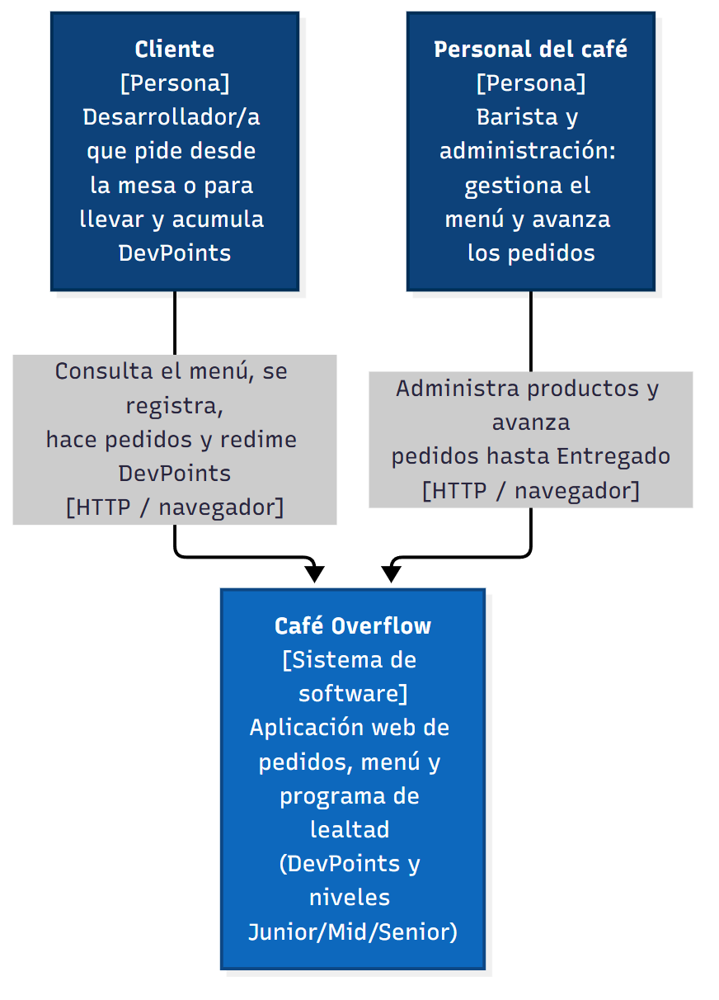
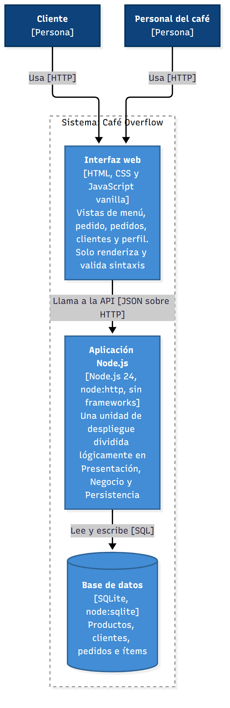
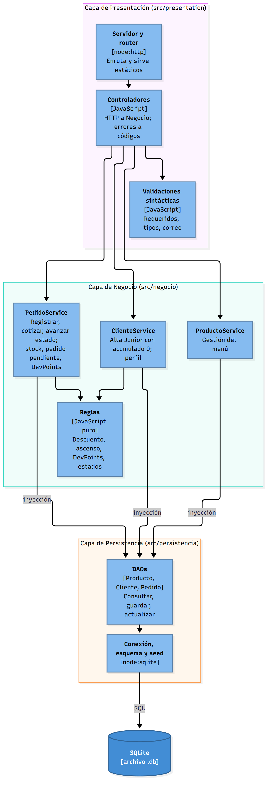
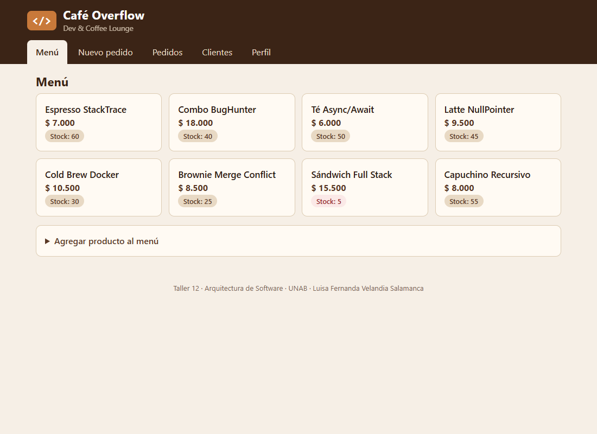
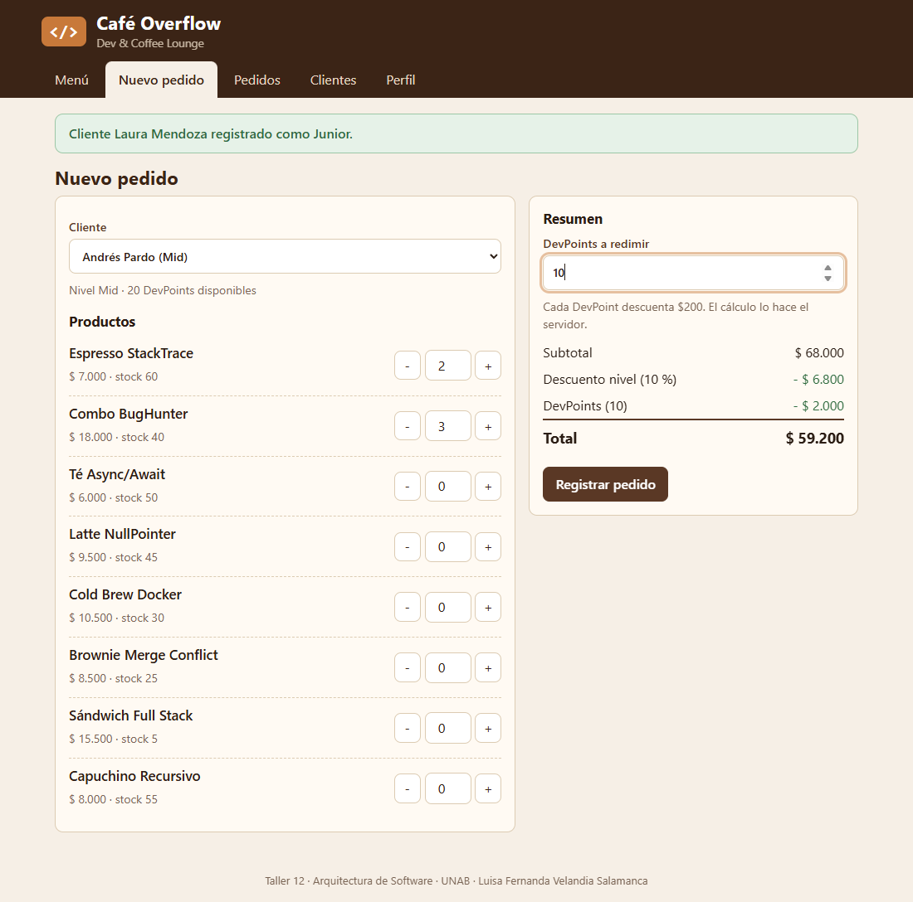
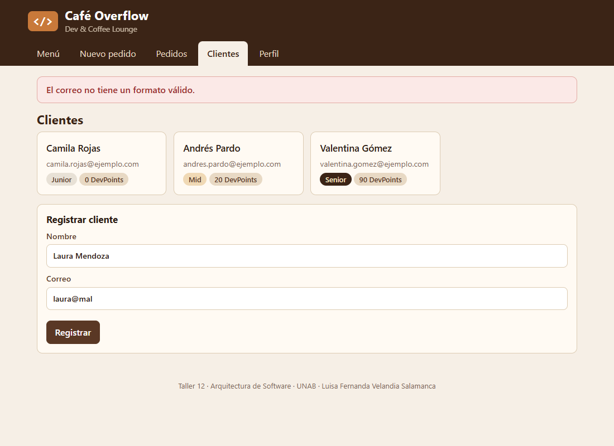
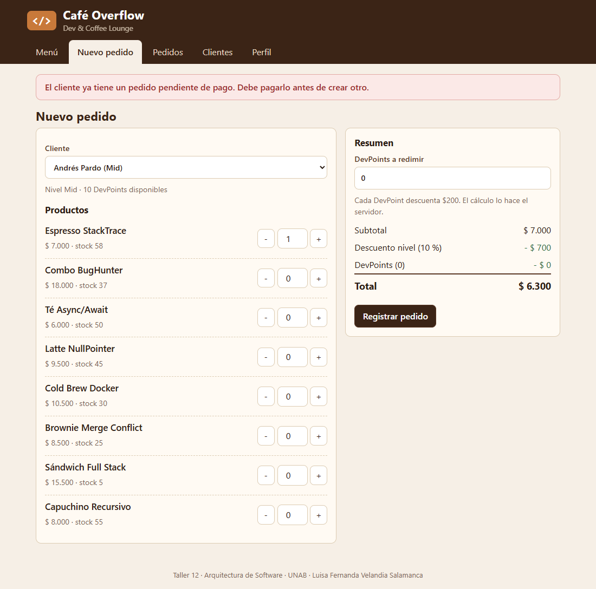
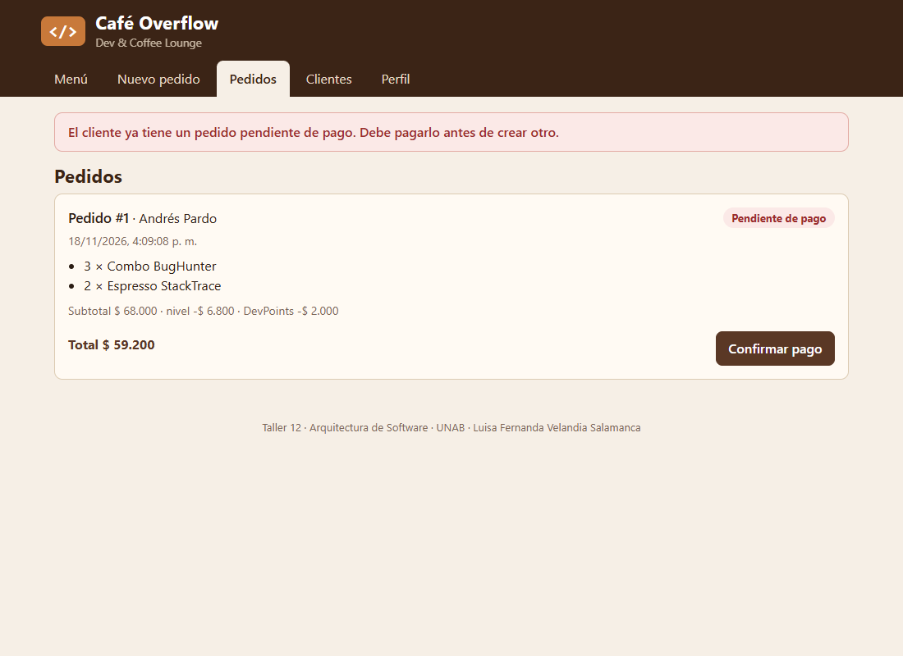
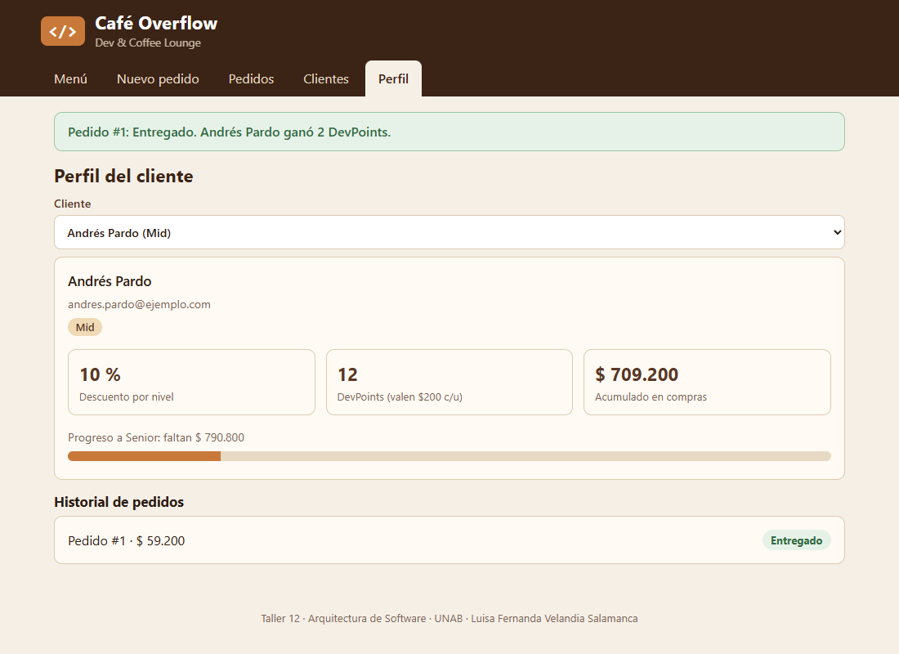

# Café Overflow - Dev & Coffee Lounge

**Taller 12 - Arquitectura de Software (N-Tier)**

| | |
|---|---|
| Estudiante | Luisa Fernanda Velandia Salamanca |
| Código | U00179371 |
| Universidad | Universidad Autónoma de Bucaramanga (UNAB) |
| Asignatura | Arquitectura de Software |
| Docente | MSc. Feisar Moreno |
| Fecha | Noviembre de 2026 |
| Repositorio | https://github.com/123LUISAV/arqui-taller12-ntier-cafe-overflow |

## Descripción

Café Overflow es un café temático para desarrolladores. Esta aplicación web permite a los clientes hacer pedidos desde la mesa o para llevar, y al personal gestionar el menú y avanzar los pedidos. Incluye un programa de lealtad con **DevPoints** y niveles **Junior / Mid / Senior** que otorgan descuentos.

La solución está dividida lógicamente en tres capas (Presentación, Negocio y Persistencia), aplicando Separación de Responsabilidades y Aislamiento de Capas, y está construida **sin frameworks**: Node.js 24 puro (`node:http`, `node:sqlite`) y HTML/CSS/JS vanilla. No tiene dependencias npm.

## Cómo ejecutarla

Requisito: Node.js 24 o superior.

```bash
npm start
```

Abrir http://localhost:3000 (se puede cambiar con la variable `PORT`). La base SQLite se crea en `data/cafe-overflow.db` con datos de demostración (8 productos y 3 clientes). Para empezar de cero basta borrar esa carpeta `data/`.

```bash
npm test
```

Ejecuta las 38 pruebas con `node --test` (reglas puras, servicios con DAOs falsos en memoria, integración con SQLite en memoria y pruebas HTTP de extremo a extremo).

## Estructura por capas

```
src/
  server.js            punto de entrada (npm start)
  app.js               composition root: conecta las tres capas
  presentation/        CAPA DE PRESENTACIÓN
    servidor.js          servidor HTTP y enrutador
    controladores.js     HTTP <-> Negocio, traducción de errores
    validaciones.js      validación sintáctica (requeridos, tipos, correo)
    http.js              lectura/escritura de JSON y archivos estáticos
    public/              index.html, estilos.css, app.js (UI vanilla)
  negocio/             CAPA DE NEGOCIO
    reglas.js            reglas puras (descuento, ascenso, DevPoints, estados)
    pedidoService.js     registrar / cotizar / avanzar estado de pedidos
    clienteService.js    alta de clientes y perfil
    productoService.js   gestión del menú
    errores.js           ErrorNegocio y códigos
  persistencia/        CAPA DE PERSISTENCIA
    conexion.js          apertura de SQLite y transacciones
    esquema.js           tablas
    seed.js              datos de demostración
    productoDao.js, clienteDao.js, pedidoDao.js
test/                  pruebas automáticas
docs/                  bitácora, diagramas C4, capturas e informe
```

Las dependencias solo apuntan hacia abajo: `presentation -> negocio -> persistencia`. Negocio no importa nada de persistencia: recibe los DAOs por **inyección de dependencias** desde `src/app.js`, por eso se puede probar con DAOs falsos.

### Qué permite y qué prohíbe cada capa

| Capa | Permitido | Prohibido |
|---|---|---|
| Presentación | Renderizar vistas, capturar formularios, validación sintáctica (requeridos, formato de correo), serializar JSON | Calcular totales, descuentos o ascensos; consultar la base de datos |
| Negocio | Descuentos, ascensos, stock, estado del pedido | HTML/JSON, tecnologías de UI, SQL |
| Persistencia | Consultar, guardar y actualizar en SQLite | Reglas de negocio |

Ejemplo: la pantalla "Nuevo pedido" no suma nada; cada vez que cambian las cantidades llama a `POST /api/pedidos/cotizar` y muestra lo que calcula Negocio.

## Reglas de negocio y dónde viven

| # | Regla | Implementación |
|---|---|---|
| 1 | Descuento por nivel: Junior 5 %, Mid 10 %, Senior 15 % | `porcentajeDescuento` y `calcularTotales` en `src/negocio/reglas.js` |
| 2 | Cliente nuevo Junior con acumulado $0 | `ClienteService.registrar` en `src/negocio/clienteService.js` |
| 2 | Ascenso a Mid (>= $500.000) y Senior (>= $1.500.000) | `nivelPorAcumulado` / `nivelResultante` en `reglas.js`; se aplica en `PedidoService.avanzarEstado` |
| 3 | 1 DevPoint por cada $20.000 de un pedido completado | `devPointsGanados` en `reglas.js`; se otorga en `avanzarEstado` |
| 3 | Cada DevPoint redimido descuenta $200 | `calcularTotales` en `reglas.js`; se descuenta del saldo en `PedidoService.registrar` |
| 4 | No registrar si cantidad > stock | `PedidoService.#prepararLineas` en `src/negocio/pedidoService.js` |
| 4 | No registrar si el cliente tiene un pedido Pendiente de pago | `PedidoService.registrar` |

Interpretaciones y decisiones están detalladas en [`docs/BITACORA.md`](docs/BITACORA.md).

## Diagramas C4

Fuentes en Mermaid (`docs/diagramas/*.mmd`) y exportados a PNG y SVG.

### Nivel 1 - Contexto


### Nivel 2 - Contenedores


### Nivel 3 - Componentes (las tres capas)


## Capturas de la interfaz

| | |
|---|---|
|  Menú |  Nuevo pedido con DevPoints |
|  Validación sintáctica |  Regla de pedido pendiente |
|  Lista de pedidos |  Perfil del cliente |

## API (resumen)

| Método y ruta | Uso |
|---|---|
| `GET /api/productos`, `POST /api/productos` | Menú |
| `GET /api/clientes`, `POST /api/clientes`, `GET /api/clientes/:id` | Clientes y perfil |
| `GET /api/pedidos`, `POST /api/pedidos` | Listar y registrar pedidos |
| `POST /api/pedidos/cotizar` | Calcula el total sin guardar |
| `POST /api/pedidos/:id/avanzar` | Avanza el estado del pedido |

## Licencia

MIT. Ver [LICENSE](LICENSE).
